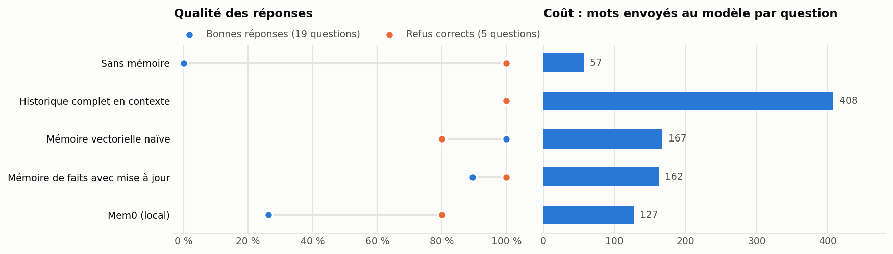

# memoire-agent-recrutement

[](https://github.com/frejoyal/memoire-agent-recrutement/actions/workflows/verification.yml)

> **Entreprise, personnes et conversations fictives.** Recrutement Élite inc., ses trois recruteurs, ses clients et leurs conversations sont inventés ; seules les villes sont réelles.
>
> **Fictional company, people and conversations.** See the [English section](#english).

La mémoire à long terme d'un assistant, mesurée. Un RAG ou un wiki répond à « qu'est-ce qui est écrit dans nos documents ? ». La mémoire d'un assistant répond à une autre question : « qu'est-ce que je sais de toi, après nos conversations ? ». Ce dépôt compare cinq façons de se souvenir, dont la bibliothèque [Mem0](https://github.com/mem0ai/mem0), sur trois utilisateurs dont les préférences changent avec le temps. Tout tourne en local, avec `gemma4:e4b` et `bge-m3`.



## Le mandat

Les recruteurs de Recrutement Élite inc. utilisent un assistant tous les jours. Ils ne veulent plus lui répéter leurs habitudes : le nombre de candidats par short-list, le jour de leurs rapports, qui mettre en copie chez un client. Le cabinet veut savoir quelle mémoire donner à l'assistant, avec trois exigences :

- se souvenir de la règle en vigueur quand une préférence change ;
- ne jamais attribuer à une personne ce qui concerne un collègue ;
- dire « je ne sais pas » plutôt qu'inventer.

## Le scénario

- **Trois utilisateurs** : Julie Ouellet et Karim Benali, recruteurs TI, et Sophie Gendreau, directrice générale. Chacun a sa mémoire, séparée de celle des autres.
- **21 conversations**, du 2 mars au 22 juin 2026, dans [donnees/conversations.json](donnees/conversations.json) : des préférences, des règles de travail, des contacts chez des clients, des événements (un candidat refusé, un placement, des vacances, une conférence) et du bavardage.
- **Trois changements** :
  - la short-list de Julie passe de 5 à 3 candidats en mai ;
  - les rapports de Karim passent du vendredi au jeudi en juin ;
  - l'objectif de délai de placement de Sophie passe de 30 à 25 jours en juin.
- **24 questions**, posées le 30 juin et figées avant les mesures, dans [evaluation/questions.json](evaluation/questions.json) : 19 ont une réponse dans les conversations. Les 5 autres demandent un refus : 3 questions sur ce qui n'a jamais été dit, et 2 où l'on demande à l'assistant la préférence d'un collègue.

## Les cinq systèmes

1. **Sans mémoire** : la référence la plus basse.
2. **Historique complet** : toutes les conversations passées de l'utilisateur sont redonnées au modèle avec la question.
3. **Mémoire vectorielle naïve** : chaque message de l'utilisateur est gardé tel quel, avec sa date ; on retrouve les 5 plus proches de la question avec `bge-m3`.
4. **Mémoire de faits avec mise à jour** ([memoire/systemes.py](memoire/systemes.py)) : le mécanisme de Mem0, écrit en clair et en français.
   - Après chaque conversation, le modèle extrait des faits durables.
   - Pour chaque fait, il voit les 5 faits proches déjà en mémoire, puis décide : ajouter, remplacer un fait (l'ancien est gardé dans l'historique, avec sa date) ou ignorer.
   - À la question, on retrouve les 5 faits les plus proches.
5. **Mem0 2.2.1 en local** ([memoire/mem0_local.py](memoire/mem0_local.py)) : la bibliothèque mem0ai, avec les mêmes modèles locaux (Ollama) et une base Qdrant locale, avec ses réglages par défaut pour le reste. Sa télémétrie est coupée.

Pour tous les systèmes, le même modèle reçoit ce que la mémoire lui rappelle et répond en une ou deux phrases, ou `INCONNU`.

## Résultats

| Système | Bonnes réponses | Refus corrects | Réponses périmées | Confusions entre utilisateurs | Souvenirs gardés | Appels LLM pour mémoriser | Mots envoyés par question |
|---|--:|--:|--:|--:|--:|--:|--:|
| Sans mémoire | 0 % | 100 % | 0 sur 3 | 0 sur 6 | 0 | 0 | 57 |
| Historique complet | **100 %** | **100 %** | 0 sur 3 | 0 sur 6 | 21 conversations | 0 | 408 |
| Mémoire vectorielle naïve | **100 %** | 80 % | 0 sur 3 | 1 sur 6 | 30 messages | 0 | 167 |
| Mémoire de faits avec mise à jour | 90 % | **100 %** | 0 sur 3 | 0 sur 6 | 36 faits | 60 | 162 |
| Mem0 2.2.1 (local) | 26 % | 80 % | 1 sur 3 | 1 sur 6 | 33 souvenirs | non mesuré | 127 |

- « Bonnes réponses » porte sur les 19 questions qui ont une réponse.
- « Refus corrects » porte sur les 5 questions où il faut refuser.
- « Réponses périmées » compte les mauvaises réponses qui donnent l'ancienne valeur d'une préférence qui a changé.
- « Confusions entre utilisateurs » compte les réponses qui donnent la valeur d'un collègue, ou qui répondent à une question sur un collègue au lieu de refuser. Les mémoires étant séparées, aucun système ne peut lire les souvenirs d'un collègue : une confusion attribue à quelqu'un ce qui ne le concerne pas.

Les réponses, et ce que chaque mémoire a rappelé pour chaque question, sont dans [resultats/resultats.json](resultats/resultats.json). Les faits retenus par la mémoire de faits sont dans [resultats/memoire-de-faits.json](resultats/memoire-de-faits.json), et les souvenirs de Mem0 dans [resultats/mem0-enregistrement.json](resultats/mem0-enregistrement.json).

### Ce qu'on en retient

1. **Avec 21 conversations, tout redonner au modèle reste imbattable.** L'historique complet répond juste à tout, ne donne aucune valeur périmée et refuse les cinq questions à refuser. Mais il coûte 408 mots par question, et ce coût grandit à chaque conversation. Les mémoires sélectives restent autour de 160 mots, peu importe la longueur de l'historique.
2. **La mémoire de faits tient ses promesses sur les changements :** aucune réponse périmée et aucune confusion. Elle garde aussi l'historique : « 3 candidats au maximum depuis le 4 mai, 5 auparavant ». Elle perd des détails à l'extraction : elle ne retient pas la date d'entrée en poste d'un candidat placé, et range le refus d'un candidat et sa raison dans deux faits séparés. Elle a aussi enchaîné trois remplacements sur les rapports de Karim et gardé « le vendredi » comme texte principal, avec « le jeudi » dans l'historique. La réponse est restée juste ici, mais c'est une fragilité.
3. **La mémoire naïve fait bien sur un petit scénario.** Les messages sont courts et datés : le modèle voit l'ancienne et la nouvelle valeur ensemble, et choisit la plus récente. Mais quand Karim demande la short-list de Julie, il répond avec sa propre préférence au lieu de refuser.
4. **Mem0, avec ce petit modèle local, invente des souvenirs.** Quelques exemples :
   - un contact « Jean Dupont » avec un courriel, chez un client ;
   - une librairie, le métro, un restaurant italien ;
   - des short-lists « réduites à 2, puis à 1 candidat » ;
   - une exigence de 5 ans d'expérience chez Manufacturier Boréal.

   Il écrit une partie de ses souvenirs en anglais, en garde plusieurs versions de certains, et ne retient que deux souvenirs de Sophie, sans le nouvel objectif de 25 jours. Sa version open source ne permet pas non plus de dater une conversation : c'est réservé à sa plateforme. Ce résultat vaut pour Mem0 2.2.1 avec `gemma4:e4b` dans sa configuration par défaut : il ne dit rien de Mem0 avec un modèle plus gros, qui n'est pas mesuré ici. Il montre surtout qu'une bibliothèque de mémoire se teste avec le modèle qu'on va réellement utiliser.
5. **Une mémoire qui extrait des faits doit être relue.** Ce que le système a « compris » n'est pas ce qui a été dit. Garder les conversations brutes comme source, comme les documents d'un wiki, permet de vérifier et de reconstruire la mémoire.

### Quand choisir quoi

- **Peu de conversations par utilisateur :** redonner l'historique complet.
- **Un historique qui grandit :** une mémoire de faits avec mise à jour et historique, dont on relit les extractions, en gardant les conversations brutes.
- **Une bibliothèque de mémoire :** la mesurer d'abord sur un scénario comme celui-ci, avec le modèle prévu.

Ce dépôt complète deux autres bancs d'essai sur le même cabinet fictif. [rag-recrutement-bench](https://github.com/frejoyal/rag-recrutement-bench) mesure la recherche dans 50 CV. [llm-wiki-recrutement](https://github.com/frejoyal/llm-wiki-recrutement) mesure un wiki compilé à partir des règles internes. Une architecture complète combinerait les trois : un RAG pour les CV, un wiki pour les règles et une mémoire pour les préférences de chaque utilisateur.

### Limites

- L'échantillon est petit : 24 questions, une exécution, un seul modèle. Une question vaut 5 points sur les bonnes réponses.
- Les conversations et les questions ont été écrites par la même personne, avant les mesures.
- La correction automatique a été ajustée une fois après lecture des réponses. Elle refusait « vous préférez être appelé » comme réponse à « comment me joindre pour une urgence ? », et la forme « appelé » a été ajoutée. Les questions n'ont pas changé.
- La seule réponse juste de Mem0 sur l'historique (« 5 candidats avant mai ») contient aussi ses souvenirs inventés (2, puis 1 candidat) : la correction automatique ne pénalise pas ce qui est ajouté.
- Mem0 appelle lui-même les modèles : ses appels ne passent pas par le cache. Ce qu'il a retenu et retrouvé est enregistré, et la CI refait les réponses et la correction à partir de cet enregistrement. Sa mémorisation a pris 44 minutes sur le poste.

## Reproduire

Le dépôt contient un cache de toutes les réponses du modèle et des vecteurs ([resultats/cache/](resultats/cache/)), et l'enregistrement de Mem0. Les résultats se recalculent sans modèle ni réseau :

```bash
pip install -r requirements.txt
python -m memoire.evaluer --verifier   # rejoue les 21 conversations et les 24 questions, compare aux résultats publiés
```

La CI fait la même chose à chaque modification du dépôt. Pour tout recalculer, il faut [Ollama](https://ollama.com) avec `gemma4:e4b` et `bge-m3`, un seul serveur Ollama à la fois, puis :

```bash
pip install -r requirements-modeles.txt
python -m memoire.mem0_local             # fait tourner Mem0 et enregistre ses souvenirs
python -m memoire.evaluer --mode direct
python resultats/graphique.py
```

## Structure

```text
donnees/       les 21 conversations fictives
evaluation/    les 24 questions et leurs réponses attendues
memoire/       les cinq systèmes, l'exécution de Mem0, les appels aux modèles et l'évaluation
resultats/     les résultats, les faits retenus, l'enregistrement de Mem0, le graphique et le cache
```

Le code a été écrit avec l'aide de Claude. Les souvenirs et les réponses viennent de `gemma4:e4b`, en local.

## English

**Fictional company, people and conversations.** Recrutement Élite inc., its three recruiters, its clients and their conversations are made up; only the cities are real.

Long-term memory for an assistant, measured. RAG and wikis answer "what is written in our documents?"; an assistant's memory answers "what do I know about you after our conversations?". This repo compares five ways to remember, including the [Mem0](https://github.com/mem0ai/mem0) library, on three users whose preferences change over time. Everything runs locally with `gemma4:e4b` and `bge-m3`.

- **Scenario:** 21 French conversations from March to June 2026 with three recruiters, each with a separate memory. Preferences change (short-list size 5 → 3, report day Friday → Thursday, placement target 30 → 25 days). 24 questions on June 30: 19 answerable, 5 to refuse (never said, or about a colleague).
- **Systems:** no memory; full history in context; naive vector memory of raw messages; a fact memory with add / replace / ignore decisions and kept history (Mem0's mechanism, written out); Mem0 2.2.1 locally with default settings and telemetry off.
- **Findings:** with 21 conversations, full history is perfect (100%) but costs 408 words per question and grows. The fact memory gets 90% with no stale answer and no user confusion, at 162 words, but loses some details during extraction. Mem0 with this small local model scores 26% and invents memories (a contact with an email address, a bookstore, short-lists "reduced to 1 candidate"), writes part of them in English, and its open-source version cannot date conversations. This says nothing about Mem0 with a larger model; it shows that a memory library must be tested with the model you will actually run.
- **Reproducibility:** every model call and vector is cached, Mem0's output is recorded, and CI recomputes every answer and grade without a model.

The code was written with help from Claude.

## Licence

[MIT](LICENSE). License: [MIT](LICENSE).
